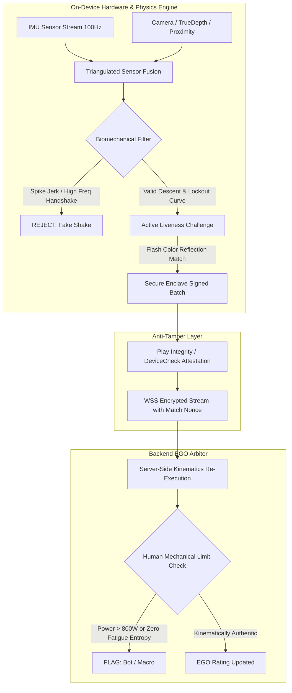

# PushGard — Physics Motion Detector & Anti-Cheat Architecture Specification

**Brand**: PushGard  
**Slogan**: *"Defend Your EGO."*  
**Core Arena**: EGO Ranking (Competitive Bodyweight Esports)

---

## 1. Physics Motion Detector: Recommended Language & Stack

### **The Verdict: Rust (or Modern C++20) compiled to a Shared Native Core**

For a mobile motion detector tracking biomechanical pushups and reps, **Rust** is the industry gold standard, with **Modern C++20** as an equivalent alternative.

### Why Not Pure Swift / Kotlin or Dart / JavaScript?

| Evaluation Dimension | Pure Swift & Kotlin | Dart (Flutter) / JS (React Native) | **Rust / C++ Core (Recommended)** |
| :--- | :--- | :--- | :--- |
| **Garbage Collection (GC)** | Pauses can occur in Kotlin JVM. | GC pauses of 15–40ms drop IMU frames; causes velocity integration drift. | **Zero GC.** 100% deterministic microsecond execution. |
| **Cross-Platform Math** | Dual codebase: floating-point rounding divergence causes iOS vs Android exploits. | Single UI codebase, but too slow for 100–200 Hz raw vector math without FFI. | **Single source of truth.** Bit-identical physics engine compiled for ARM64 iOS and Android. |
| **Direct Hardware FFI** | Native. | Needs FFI bridge (Dart FFI / JSI Nitro). | **Zero-copy memory sharing** via raw pointer buffers. |
| **Binary Reverse Engineering** | Bytecode easily decompiled with JADX / Hopper. | Dart AOT / Hermès bytecode is unpackable. | **Heavily stripped native machine code**; resistant to static decompilation. |

### Recommended Production Architecture:

```
┌─────────────────────────────────────────────────────────────┐
│                 PUSHGARD MOBILE APP (SHELL)                 │
│              (Flutter, React Native, or Swift/Kotlin)       │
│   - UI / UX Animations & 1v1 Matchmaking Screens            │
│   - Hardware Camera & IMU Sensor Collectors (100–200 Hz)    │
└──────────────────────────────┬──────────────────────────────┘
                               │ Zero-Copy FFI Pointer Passing
┌──────────────────────────────▼──────────────────────────────┐
│        PUSHGARD PHYSICS CORE (Rust / C++20 Library)         │
│  ├── 1. Bandpass Filter & Gravity Separation (Butterworth)  │
│  ├── 2. Extended Kalman Filter (EKF) Orientation Estimator  │
│  ├── 3. Kinematic Double-Integrator (Disp = ∫∫ (a - g) dt)  │
│  ├── 4. Zero-Crossing & Turnaround Inflection Detector     │
│  └── 5. Anomaly & Jerk Anti-Cheat Classifier               │
└──────────────────────────────┬──────────────────────────────┘
                               │ Encrypted & Signed Entropy Stream
┌──────────────────────────────▼──────────────────────────────┐
│              PUSHGARD BACKEND (Rust / Go Server)            │
│  - Play Integrity / DeviceCheck Hardware Attestation Verify  │
│  - Match Nonce Verification & Server-Side Kinematic Audit    │
│  - EGO Rating Calculator (Dynamic K-Factor Elo Engine)      │
└─────────────────────────────────────────────────────────────┘
```

---

## 2. The Battle-Hardened Anti-Cheat Architecture ("Hard to be Cheated")

Cheaters in pushup/calisthenics apps fall into three categories:
1. **Physical Cheats**: Half reps, shaking the phone with hands, waving hand over proximity sensor, sagging hips (worming).
2. **Digital Spoofing**: Injecting recorded sensor data using Magisk/Xposed or simulated emulators.
3. **Memory / Network Tampering**: Memory editing (Frida, GameGuardian) to set `reps = 999` or forging HTTP requests.

PushGard employs a **5-Layer Defense-in-Depth** model:



---

### Layer 1: Sensor Fusion Triangulation (Physical Anti-Cheat)

A real pushup produces an inescapable biomechanical signature governed by Newtonian physics:

1. **The Chest-Floor Harmonic Oscillator**:
   - When the chest approaches the floor, proximity distance $d(t) \le 5\text{ cm}$.
   - Simultaneously, vertical acceleration $a_z(t)$ must show a deceleration curve, reaching an instantaneous zero-velocity turnaround ($v_z = 0$), followed by a positive thrust jerk ($J_z = \frac{da_z}{dt} > 0$) as the pectorals fire.
2. **Rejection of Hand-Shaking & Bed Bouncing**:
   - Shaking a phone by hand produces high frequencies ($f > 4\text{ Hz}$) with high angular velocity variance ($\Delta \omega_x, \Delta \omega_y$).
   - A real pushup is a constrained pivot around the athlete's toes. The pitch angle $\theta(t)$ must tilt predictably between $6^\circ$ and $18^\circ$. If tilt $> 35^\circ$ or changes erratically, the rep is disqualified.
3. **Full Range of Motion (ROM) Enforcement**:
   - The app establishes a calibrated "Lockout Baseline" at the start of each set.
   - A rep only counts if:
     $$\text{Descent Depth} \ge 75\% \times \text{Baseline ROM} \quad \text{AND} \quad \text{Full Lockout Reached Within } 5\%$$

---

### Layer 2: Dynamic Challenge-Response & Active Liveness

To defeat **pre-recorded video playback** (pointing the camera at an iPad screen) and **recorded sensor replays**:

1. **Randomized Spectral Reflection ("The Screen Pulse")**:
   - During ranked battles, the phone's screen flashes a cryptographically pseudorandom hue (e.g. Cyan `#00ffff` at Rep 4, Molten Crimson `#ff1e44` at Rep 9).
   - The front camera inspects the average pixel intensity of the athlete's chest/face. If the reflection spectrum does not match the random screen pulse within 80ms, the match is aborted for video replay.
2. **Unpredictable "Ego Holds"**:
   - In 1v1 EGO battles, the server commands unexpected micro-challenges:
     > *"HOLD AT THE BOTTOM FOR 2.0 SECONDS!"*
   - The athlete must freeze at $< 5\text{ cm}$ altitude. A macro or recorded script will blast through the rep and immediately lose the round.

---

### Layer 3: Hardware Attestation & Entropy Signing

1. **Hardware Integrity**:
   - **iOS**: Apple `DCAppAttestService` validates that the binary is unmodified, running on genuine Apple hardware, and not jailbroken.
   - **Android**: `PlayIntegrity` API (MEETS_STRONG_INTEGRITY) rejects rooted devices, unlocked bootloaders, and emulators.
2. **Rolling Nonce & Hardware Signing**:
   - When a match begins, the server issues a unique 256-bit `match_nonce`.
   - Every 2 seconds, the Rust core hashes the raw IMU sensor stream concatenated with the nonce:
     $$\text{Token} = \text{Sign}_{\text{SecureEnclave}}(\text{SHA256}(a(t) \mathbin{\Vert} \omega(t) \mathbin{\Vert} \text{nonce} \mathbin{\Vert} t))$$
   - A cheater cannot intercept or replay packets because they lack the hardware-backed private key and cannot predict the server nonce.

---

### Layer 4: Server-Side Kinematic Audit ("The EGO Arbiter")

The mobile client **never** sends `{"reps": 50}` to the server. Instead:
- The client streams compressed, quantized time-series chunks of kinetic data.
- The server re-runs the physics validator in a headless container:
  1. **Fatigue Entropy Check**: Real humans fatigue. The time interval between reps $\Delta t_i$ naturally increases asymptotically (e.g., $1.1\text{s} \to 1.3\text{s} \to 1.9\text{s} \to 2.8\text{s}$). If rep cadence variance $\sigma^2 \approx 0$ (robotic precision), the account is flagged.
  2. **Biomechanical Energy Limit**: The physical work done per pushup is roughly $W = 0.65 \cdot m \cdot g \cdot h$. If a reported 60-second set implies mechanical power output $> 600\text{ Watts}$, it exceeds human physiological capacity.

---

### Layer 5: Client Memory & Binary Hardening

1. **Anti-Frida & Anti-Debugging**:
   - Rust core invokes native syscalls (`ptrace(PTRACE_TRACEME, ...)` on Linux/Android) to block debuggers.
   - Active memory scanning for Frida injected threads, named pipes (`/data/local/tmp/frida-*`), and Magisk Zygisk hooks.
2. **Polymorphic In-Memory Score Masking**:
   - The verified rep count is never stored as a naked integer in RAM. It is stored as an XOR-masked pair:
     $$\text{RepCount} = \text{MaskedVal} \oplus \text{SecretKey}(t)$$
   - Both the mask and memory address mutate every frame. Memory scanners like GameGuardian or Cheat Engine see only fluctuating random bytes.

---

## 3. The PushGard EGO Ranking Formula

Unlike chess ELO, physical performance degrades if unranked, and requires victory margins (reps ahead):

$$\Delta \text{EGO}_A = K \cdot \left( S_A - \frac{1}{1 + 10^{(\text{EGO}_B - \text{EGO}_A) / 400}} \right) + \alpha \cdot \ln(1 + \Delta \text{Reps})$$

Where:
- $K$: Dynamic factor (Higher for rookies to calibrate quickly, stable for Titans).
- $\alpha \cdot \ln(1 + \Delta \text{Reps})$: **Margin of Dominance Bonus** (destroying an opponent by 20 pushups yields higher EGO reward than winning by 1).
- **Decay Clause**: Uncontested EGO ranks $> 2000$ decay by $-15\text{ EGO}$ per 7 days of inactivity to enforce continuous warrior readiness.
